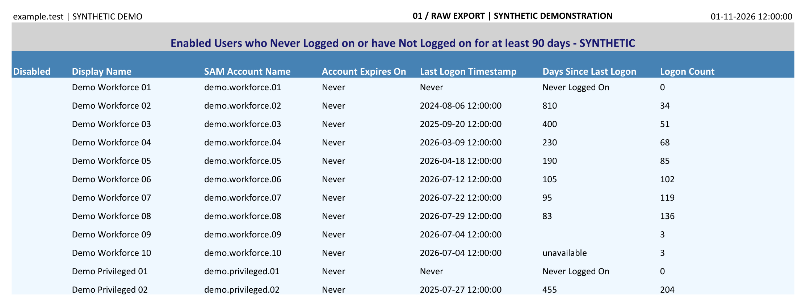
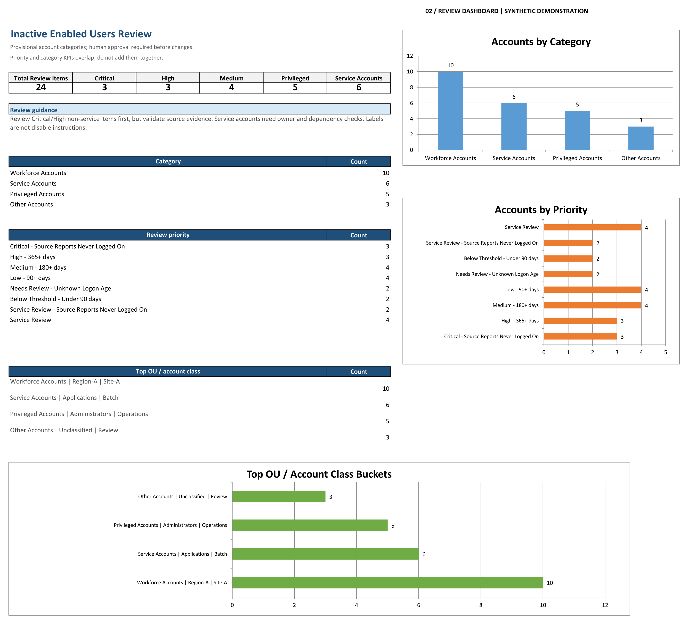
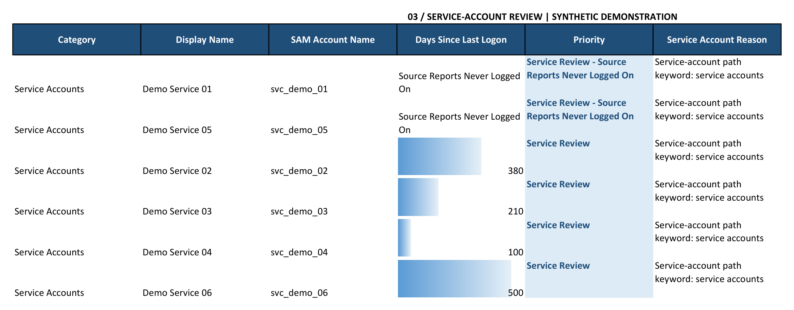

An inactive-account export can tell you where to start looking. It cannot tell you which accounts are safe to disable.

A former employee's account, an emergency-access identity and a service account can all appear in the same spreadsheet. Treating them as one cleanup list is a good way to turn an audit into an outage.

I built this project around that distinction. PowerShell collects the directory evidence. Python turns the export into separate review queues, summaries and a dashboard. The final decision stays with the people responsible for the account and the systems that depend on it.

**The goal is a defensible review process—not a bulk-delete script.**

> All workbook images below use generated, fictional data. Names, domains, paths, dates and totals are illustrative. No employer workbook or real account information is included in the repository or these images.

## The workflow

The project has two stages:

1. **Collect:** query authorized Active Directory data and create a familiar, MaxPowerSoft-style Excel report.
2. **Prepare for review:** normalize that report, separate account types and organize the results by review priority.

Neither stage disables accounts, deletes objects, resets passwords or changes directory attributes. The output is evidence for an approved remediation process.

The code and operating instructions are in [AD Account Hygiene Reporting on GitHub](https://github.com/r0cstar09/ad-account-hygiene-reporting).

## Stage one: collect useful evidence without changing AD

`Export-InactiveADUsers.ps1` runs in Windows PowerShell with the RSAT ActiveDirectory module and an identity permitted to read the required data. It uses built-in .NET functionality to write the workbook; Excel and the ImportExcel module are not required.

The export keeps the familiar fields: display name, SAM account name, directory paths, account expiry, password-set and creation dates, logon timestamp, displayed inactivity age and logon count. It also preserves the report's merged title, frozen headings and date/`Never` conventions.



*Figure 1. Synthetic input in the export layout. Some columns are hidden for readability; this is not a redacted production report.*

There is an important detail behind the dates. `lastLogon` is not replicated between domain controllers. Microsoft documents querying each DC and taking the largest value to establish the recorded last logon across the domain.[1] `lastLogonTimestamp` follows an update interval and is not a real-time record of every authentication.[2]

The collector makes those choices explicit. Its compatibility default selects rows using `lastLogonTimestamp`, while the displayed age uses the greatest observed `lastLogon`. An account can therefore appear in a timestamp-based 90-day export while its displayed age is below 90 days.

For operational cleanup review, I would start with the more conservative selection option:

```powershell
.\Export-InactiveADUsers.ps1 -Days 90 `
    -InactivityBasis LastLogon -UseTimestampSafetyNet `
    -DayCalculation ElapsedDays `
    -OutputPath 'C:\Reports\Inactive90-Review.xlsx'
```

That mode uses the latest observed `lastLogon`, with a newer replicated timestamp acting as a selection safety net. It intentionally differs from simply reproducing the source report's selection behavior.

By default, the collector reads all discovered DCs required by its selected options. Failed queries or missing baseline objects stop the report instead of silently producing a reassuring but incomplete spreadsheet. An audit sidecar records the scope, controllers, settings and output hash. Both files need access-controlled storage.

## Stage two: separate the review work

The Python processor reads the workbook locally. It does not need AD credentials or a connection to a domain controller.

Its main job is to turn one flat export into four practical queues:

- **Workforce Accounts:** accounts to reconcile with employment, leave and identity-lifecycle records.
- **Privileged Accounts:** accounts identified by configured directory paths for a closer access review.
- **Service Accounts:** likely non-human identities that need an application or system owner involved.
- **Other Accounts:** records that do not fit the configured rules and still need a decision.

Those are provisional classifications. An OU name does not prove effective privilege. A naming pattern does not prove an account is a service identity. The rules help route work; they do not replace verification.

Organization-specific paths and naming rules belong in an ignored local configuration file. The repository contains only generic examples. That makes the processor reusable without publishing an organization's directory structure.

```bash
python ad_account_hygiene_report.py \
    /secure/Inactive90.xlsx \
    /secure/Inactive90-Review.xlsx \
    --config private_rules.json
```

The output includes the processed population, separate account sheets, summaries and an opening dashboard. The main category sheets partition the population; convenience views and summaries should not be added together as if they were different accounts.



*Figure 2. Actual processor output from the fictional dataset. These totals demonstrate the workflow; they are not findings from a real environment.*

## Priority is a prompt to investigate

For non-service accounts, a source `Never` sentinel receives the `Critical` review label. Recorded ages of at least 365 days are `High`, 180–364 days are `Medium`, and 90–179 days are `Low`. Service accounts instead receive separate `Service Review` priorities. Recent activity and missing or invalid values stay visible rather than being forced into a misleading category.

A `Critical` label here means **review first**, not “confirmed security incident” or “safe to delete.” A newly provisioned account can legitimately have no recorded logon. Microsoft defines a zero `lastLogon` value as unknown, so the source-compatible `Never` wording is not proof that an identity has never authenticated.[1]

The same caution applies to logon counts. They are maintained separately on DCs, have a per-controller limit and cannot recover history from retired controllers.[3] I would not use them as a lifetime authentication record.

This is also why the workbook cannot answer every inactivity question. It does not establish cloud-only sign-in activity, application-specific usage or cached offline Windows logons.

## Why service accounts get their own queue

A service identity deserves a different conversation from a workforce account. Before changing it, someone needs to confirm what uses it, who owns it and how the change can be reversed.



*Figure 3. The separate service-account queue. Visible match reasons make the classification reviewable; they are not proof that an account is unused.*

My review sequence would be:

1. Confirm the collection scope, timestamps and any data inconsistencies.
2. Identify the account owner and verify the account's actual privilege.
3. Check services, scheduled tasks, integrations and relevant application logs.
4. Record the proposed action, evidence and approval in the organization's system of record.
5. Follow an approved, reversible change process where policy permits, then monitor and recheck.

Emergency-access accounts, seasonal use, leave and newly created identities need explicit handling. They should not disappear into an automated deletion rule.

## What is verified—and what is not

The project includes offline PowerShell tests using synthetic AD cmdlet mocks, Python regression tests and a reproducible fictional dataset. These checks exercise the collector's branching and workbook writer, the processor's classification and edge cases, and the generated workbook structure. The images here were rendered from those generated workbooks in desktop Excel.

That is not a claim of live AD validation. Real directory permissions, replication health, organizational mappings and operational dependencies still require an authorized pilot.

The useful result is a repeatable path from raw directory evidence to an explainable decision per account. The scripts handle collection and organization. Human review determines what should actually change.

## Sources

[1] https://learn.microsoft.com/en-us/windows/win32/adschema/a-lastlogon
[2] https://learn.microsoft.com/en-us/windows/win32/adschema/a-lastlogontimestamp
[3] https://learn.microsoft.com/en-us/windows/win32/adschema/a-logoncount
