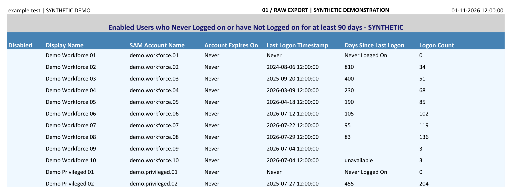
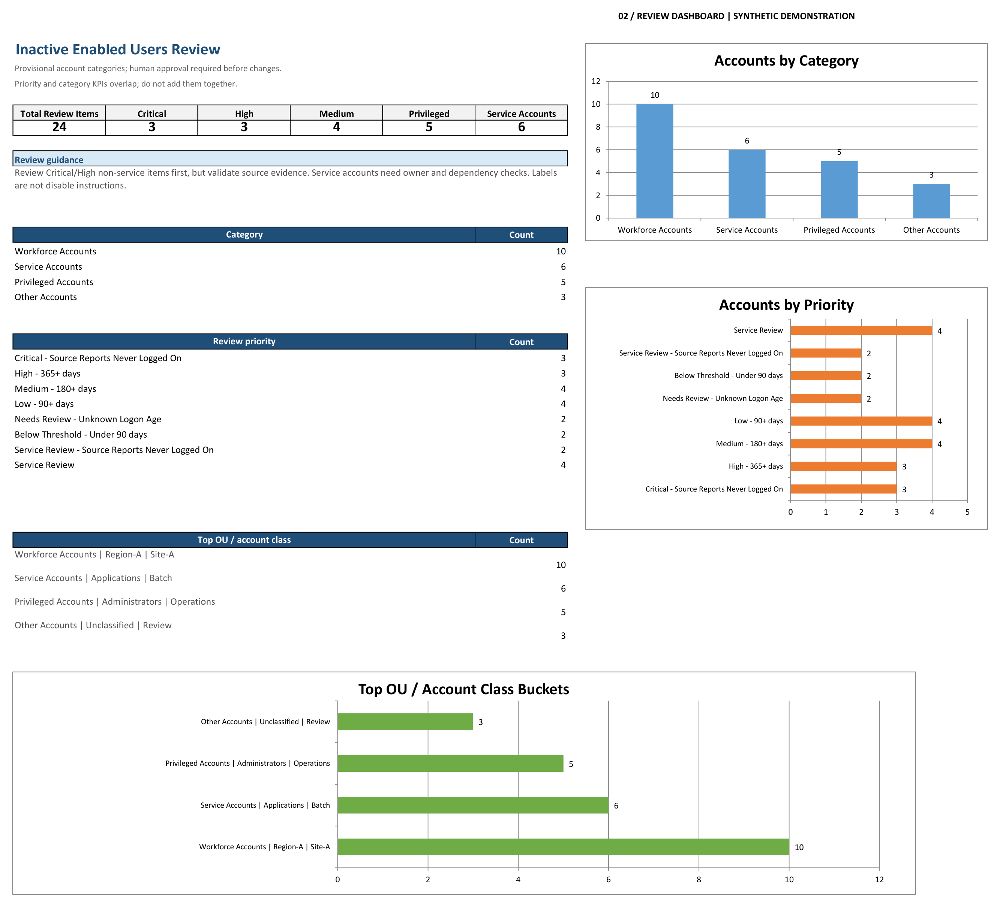
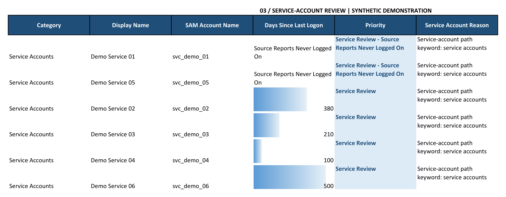

# Demonstration images

All three images are rendered by desktop Microsoft Excel from deterministic **synthetic** workbooks. No production sheet was blurred, redacted or embedded. These are worksheet renderings, not fabricated app screenshots.

Names, domain, paths, timestamps and totals are fictional. The input is created with `samples/make_sample_report.py`; the processed workbook is created by the actual Python CLI using `sample_config.json`.

For readability, the export and service views show selected columns, print layout wraps long labels, and whitespace is cropped after native Excel PDF export. The underlying source workbooks are opened read-only and not saved by the rendering step. PNG metadata is empty. No operational workbook is committed.

## Input excerpt

## Actual generated dashboard

## Service-account queue

These are the exact image files proposed for the accompanying article. Publication remains subject to owner approval.
